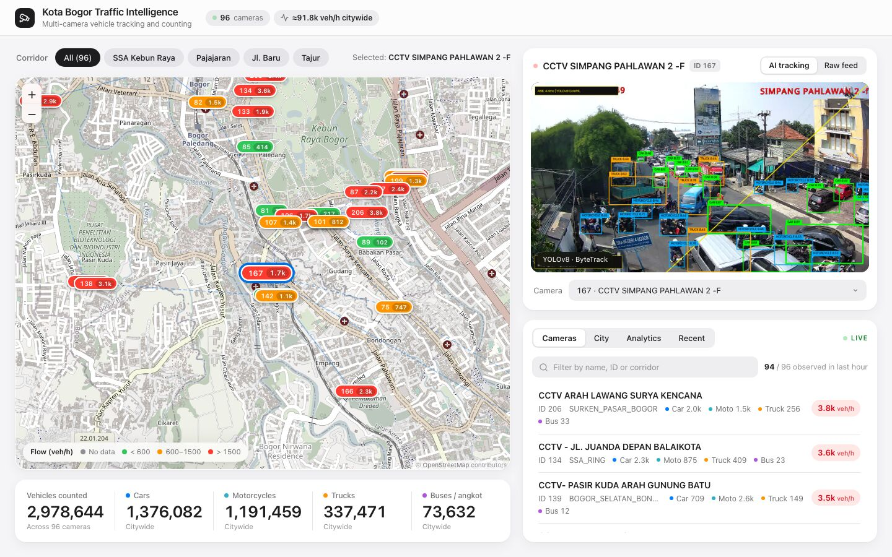
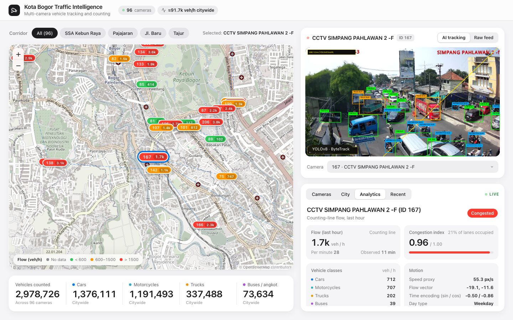
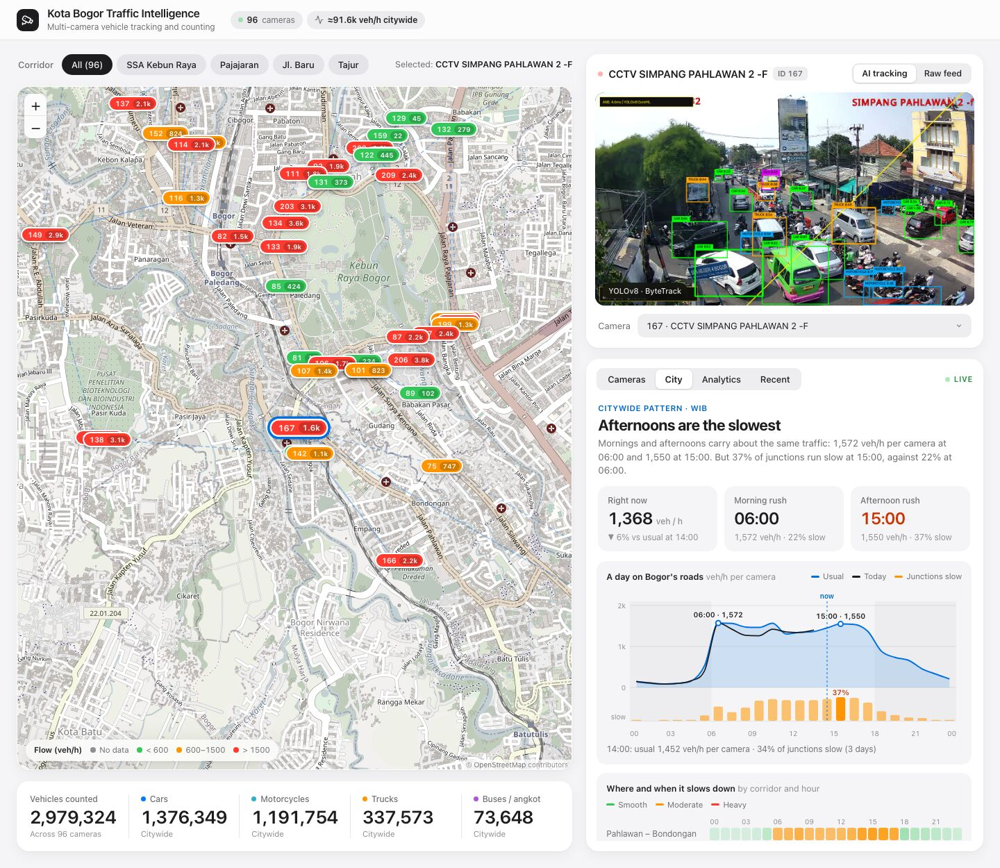
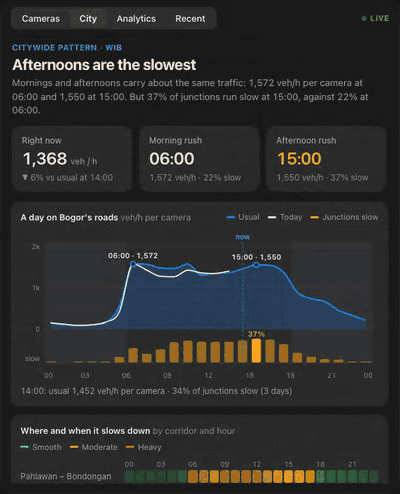
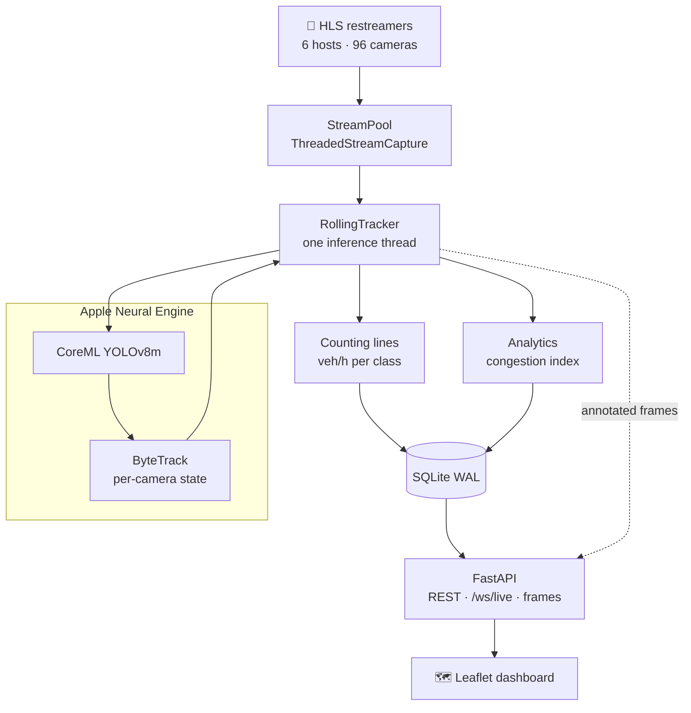
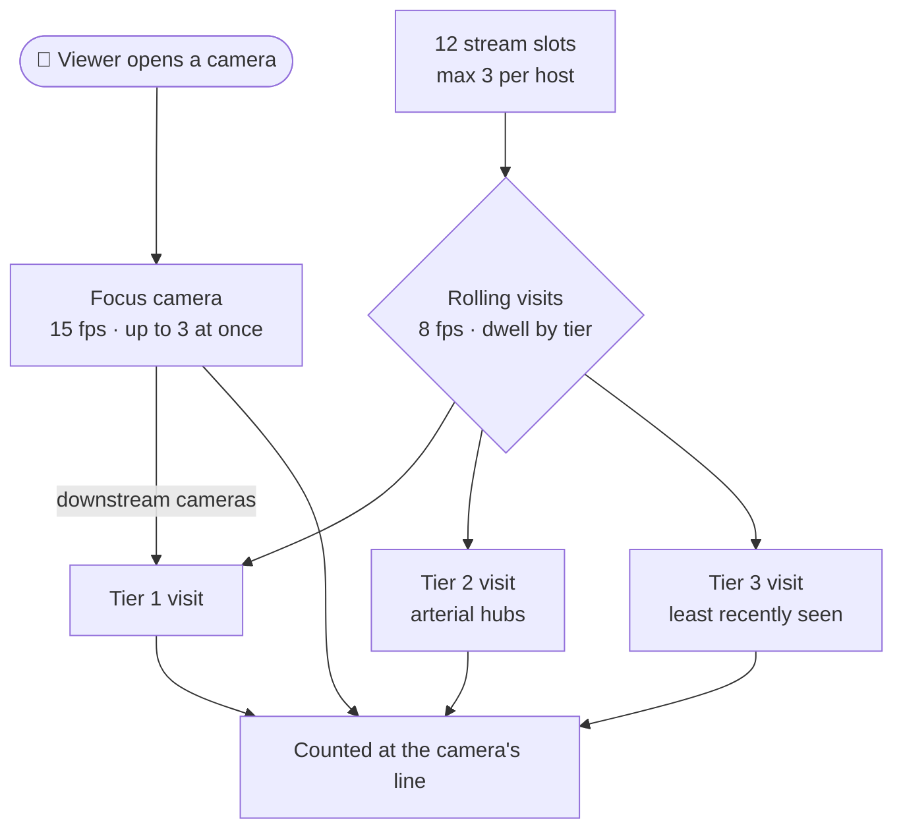
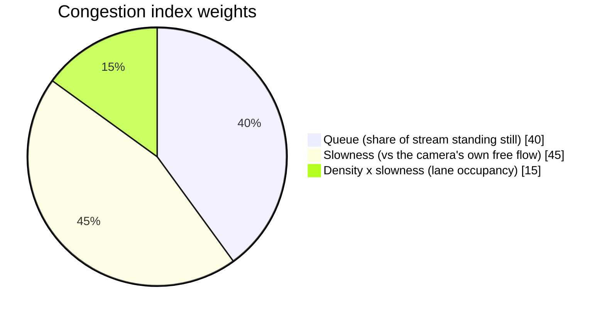

<div align="center">

# 🚦 Kota Bogor Traffic Intelligence

**96 municipal CCTV feeds → YOLOv8 on the Apple Neural Engine → live vehicle counts and congestion for a whole city.**


<picture>
  <source media="(prefers-color-scheme: dark)" srcset="docs/images/dashboard-dark.jpg">
  
</picture>

<sub>Map of per-camera flow (veh/h) on the left, live YOLOv8 + ByteTrack feed on the right. Every box is drawn on the Neural Engine.</sub>

</div>

---

## ✨ What you get

| 🗺️ **Live map** | 📈 **Counting lines** | 🚥 **Congestion index** | 🏙️ **City patterns** |
| :--- | :--- | :--- | :--- |
| Every camera on a Leaflet map, coloured by flow | Vehicles counted as they cross a learned line, in veh/h per class | Smooth → Congested, judged on the moving stream only | When Bogor slows down, where, and who is on the road |

---

## 📸 Tour

<table>
<tr>
<td width="50%" align="center">
<b>Analytics</b> · flow, congestion, export<br/>
<picture>
  <source media="(prefers-color-scheme: dark)" srcset="docs/images/analytics-dark.jpg">
  
</picture>
</td>
<td width="50%" align="center">
<b>City</b> · citywide rhythm of a day<br/>
<picture>
  <source media="(prefers-color-scheme: dark)" srcset="docs/images/city-dark.jpg">
  
</picture>
</td>
</tr>
</table>

<div align="center">
  
  <br/><sub>The City tab: slow-down heatmap by corridor and hour, hotspot ranking, vehicle mix.</sub>
</div>

---

## 🧠 How it works



All inference lives in one worker thread. The server is a thin layer: it serves REST, a `/ws/live` heartbeat, and long-polled annotated frames.

### 👀 Who gets watched when

There are only **12 stream slots** (max 3 per restreamer host) for 96 cameras. So the tracker watches the cameras you are looking at closely, and rotates through the rest.



Result: every camera still gets counted. Rates are computed over the time a camera was actually observed, so a camera seen 12 s at a time is not read as quiet the rest of the hour.

---

## ⚡ Numbers

| | |
| :--- | :--- |
| 📹 Cameras | **96** across 6 restreamer hosts |
| ⏱️ Detection | **~3.7 ms** per 720p frame on the ANE |
| 🚀 Throughput | **~75 fps** total, 11 rolling visits observing |
| 🪟 Stream slots | **12** open at once, ≤ 3 per host |
| 🎯 Focus / rolling rate | **15 fps** / **8 fps** |
| 🚦 Congestion labels | <0.25 **Smooth** · <0.55 **Moderate** · <0.8 **Heavy** · else **Congested** |



---

## 🚀 Quickstart

macOS on Apple Silicon, Python 3.11.

```bash
python3.11 -m venv .venv && .venv/bin/pip install -r requirements.txt
.venv/bin/yolo export model=yolov8m.pt format=coreml nms=True   # → yolov8m.mlpackage
./start.sh                                                       # dashboard at http://127.0.0.1:8000
.venv/bin/python3.11 -m pytest -q                                # offline test suite
.venv/bin/python3.11 scripts/export_dataset.py --start 2026-10-11 --end 2026-10-12 --bucket 15 --format csv --raw all
```

> [!WARNING]
> **The dashboard has no authentication.** `./start.sh` binds `0.0.0.0` so anyone on your LAN can open it. For local-only use run `HOST=127.0.0.1 ./start.sh`.

---

## 📚 Details

<details>
<summary><b>Congestion index: how a jam is told from a car park</b></summary>

Only the *traffic stream* is judged. Each track is one of:

| State | Meaning |
| :--- | :--- |
| **traffic** | moved ≥ 0.6 body sizes since first seen |
| **queued** | still, but standing where moving traffic drives (after 2 s) |
| **parked** | still ≥ 6 s and *not* in a lane |
| **undetermined** | young and still |

"Where traffic drives" is a per-camera **lane map**: a decaying heat map of the ground footprints of moving vehicles (`data/traffic_lanes.npz`). Speeds and distances are in *body sizes per second*, so near and far vehicles, and different cameras, compare. Slowness is measured against each camera's own free-flow speed (p85 of its traffic speeds).

Known limits: red-light stops read as queueing, and a vehicle parked inside a lane reads as queued.
</details>

<details>
<summary><b>Counting lines and volume</b></summary>

- Each camera has a **learned counting line** (`data/counting_lines.json`), in "passage" mode until it has seen 12 trajectories. A track counts when its start and current points are on opposite sides of the line and it moved ≥ 3% of the frame.
- Crossings are stored in `observation_windows` together with the seconds observed; rates come from `crossings ÷ observed time`. Rates from < 60 s of observation are flagged `low_sample`.
- Hand-placed lines (and `exclude` for cameras with no road, such as parks) live in `data/counting_line_overrides.json` and win over learned ones.
- `line_quality`: `manual` · `learned` · `low` · `passage`.
- *Sightings* (a track seen for a few frames) feed the Recent tab and raw exports, not volume.
</details>

<details>
<summary><b>Throughput: why it is fast</b></summary>

- `CoreMLDetector` calls the CoreML NMS-pipeline export directly instead of going through Ultralytics' predictor, which cost 4–7 ms of GIL-holding CPU per frame.
- 16:9 frames use `yolov8m_384x640.mlpackage` (same detections, ~40% less ANE time); 704×576 cameras keep the 640×640 model.
- Stream capture plays HLS out in real time against the stream clock and converts only the frames due at the target fps.
- Rejected after measuring: `yolov8n` (finds ~33% fewer vehicles), batched/dynamic exports (fall off the ANE), a second inference thread (the ANE serialises requests).

Second model export, for 16:9 cameras:

```bash
.venv/bin/yolo export model=yolov8m.pt format=coreml imgsz=384,640 nms=True   # rename to yolov8m_384x640.mlpackage
```
</details>

<details>
<summary><b>REST / WebSocket API</b></summary>

| Endpoint | Description |
| :--- | :--- |
| `GET /api/cameras` · `/api/cameras/{id}` | Camera metadata, GPS, corridor, stream URL |
| `GET /api/cameras/counts` | Counts, per-camera rates, `citywide_vph` |
| `GET /api/cameras/{id}/metrics` | Flow series and congestion for the Analytics tab |
| `GET /api/cameras/{id}/typical-week` | Typical congestion per weekday and hour |
| `GET /api/insights/citywide?days=7` | Data behind the City tab |
| `GET /api/topology` | Camera nodes, directed edges, corridors |
| `GET /api/stream/{id}/frame?after=<X-Frame-No>` | Annotated JPEG; long-polls ≤ 1 s, `204` if no newer frame |
| `GET /api/stats` · `/api/recent` | Sighting totals and the latest sightings |
| `GET /api/daemon/status` | Rolling tracker status: visits, coverage, `model_loaded` |
| `GET /api/export/dataset` · `/raw` · `/dictionary` | CSV/JSONL export, ≤ 31 days |
| `WS /ws/live` | Heartbeat with citywide counts and recent sightings |

Video is a long-poll rather than MJPEG or WebSocket because MJPEG stalls in Safari/WebKit.
</details>

<details>
<summary><b>Exporting data for analysis</b></summary>

`scripts/export_dataset.py` (and the Export panel in the Analytics tab) writes a tidy per-camera time series: fixed WIB-aligned buckets, crossings and observed seconds prorated by overlap, veh/h overall / per class / per direction, `coverage_ratio`, length-weighted congestion and speed, and local time features with sin/cos encodings. `--seq-len/--horizon/--target` emit npz sequence tensors; Parquet needs `pyarrow`.

Each camera is watched only during visits (mean coverage ~12% of a 15-minute bucket when observed), so weight or filter by `observed_s`.
</details>

<details>
<summary><b>Project layout</b></summary>

```
backend/        server.py (FastAPI) · rolling_tracker.py · stream_capture.py · counting.py
                database.py · dataset.py · insights.py · topology_engine.py · maintenance.py
car_tracker/    CoreMLDetector + ByteTrack · analytics.py · congestion.py
frontend/       index.html · app.js · city.js · styles.css   (no build step)
data/           bogor_camera_topology.json · counting_line_overrides.json · runtime DBs
scripts/        export_dataset.py · start_daemon.sh · stop_daemon.sh
tests/          pytest suite (offline, writable data redirected to a temp dir)
scrape_cctv_streams.py   re-scrape bsw.kotabogor.go.id; syncs topology JSON + DB
```

Run under `caffeinate` with `scripts/start_daemon.sh` / `stop_daemon.sh`. Refresh the camera list with:

```bash
.venv/bin/python3.11 scrape_cctv_streams.py
```
</details>

<details>
<summary><b>Troubleshooting</b></summary>

- **No detections / empty roads:** `/api/daemon/status` → `model_loaded`. Without a loadable model the detector returns nothing and frames are skipped, so an outage never reads as "0 veh/h"; loading is retried every 60 s.
- **`Errno 24` (too many open files):** `start.sh` raises `ulimit -n`; do the same if you launch uvicorn yourself.
- **Noisy FFmpeg logs:** `OPENCV_LOG_LEVEL=ERROR` and `OPENCV_FFMPEG_LOGLEVEL=8` (set by `start.sh`).
- **Cameras stuck on "connecting":** the municipal restreamers limit connections and some cameras are flaky; dead cameras and hosts back off with jitter.
</details>

---

<sub>Data: CCTV feeds from **Bina Sarana Wilayah (BSW) Pemerintah Kota Bogor** (`bsw.kotabogor.go.id`). Built with [Ultralytics YOLOv8](https://github.com/ultralytics/ultralytics), [Core ML Tools](https://github.com/apple/coremltools) and [ByteTrack](https://github.com/ifzhang/ByteTrack).</sub>
