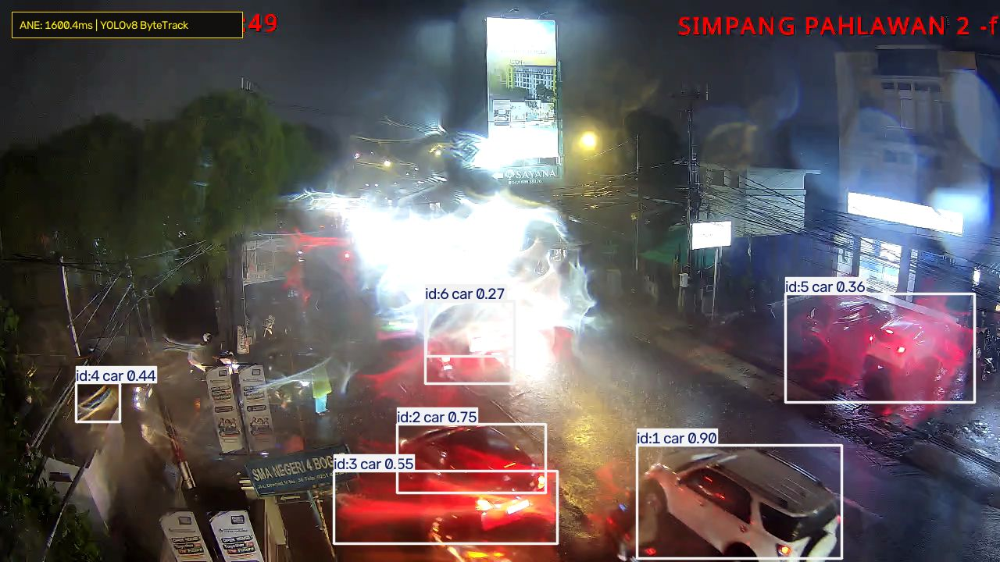
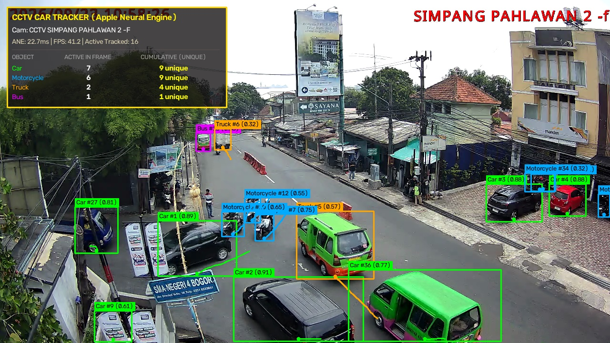
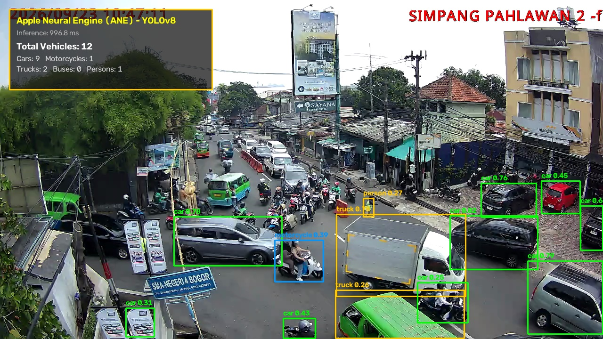

# 🚦 BSW Kota Bogor — Multi-Camera Traffic Intelligence & Vehicle Tracking (MTMC)

[-555555?logo=apple&logoColor=white)](https://apple.com)
[](https://ultralytics.com)
[-00FF66)](https://github.com/ifzhang/ByteTrack)
[](https://fastapi.tiangolo.com)
[](https://leafletjs.com)
[](tests/)

An enterprise-grade, end-to-end intelligent transportation surveillance platform that scrapes all **94 municipal CCTV cameras** from the Kota Bogor government (`bsw.kotabogor.go.id/cctv`), executes real-time vehicle detection and multi-object tracking accelerated locally on the **Apple Neural Engine (ANE)**, and turns them into citywide traffic volume and congestion analytics.

---

## 📸 System Previews

<div align="center">
  
  <p><i>Live detection and ByteTrack ID assignment running on ANE (~11.8ms inference) at Simpang Pahlawan during nighttime rain.</i></p>
</div>

<br/>

<div align="center">
  
  
  <p><i>Left: Dynamic trajectory tracking & motion vectors. Right: Multi-class vehicle classification (cars, motorcycles, angkot, trucks).</i></p>
</div>

---

## ⚡ Key Architecture & Features

### 1. Apple Neural Engine (ANE) Acceleration
- **Zero-Cloud, Ultra-Low Power**: Inference runs directly on Apple Silicon Neural Engine (`ComputeUnit.CPU_AND_NE`) via CoreML.
- **Sub-12ms Latency**: `YOLOv8m` runs in **~11.7ms – 18.5ms** (~60–85 FPS), enabling real-time multi-camera processing with negligible CPU/GPU thermal impact.
- **Strict COCO Vehicle Filtering**: Detects and classifies `car` (2), `motorcycle` (3), `bus / angkot` (5), and `truck` (7).

### 2. 94-Camera Geocoded Road Network Topology Graph
- **Complete Citywide Master Database**: All 94 cameras geocoded with precise GPS coordinates, compass azimuths, and corridor groupings.
- **220 Directed Transitions**: Modeled road adjacency graph reflecting real-world road physical constraints.
- **Strict One-Way Directional Enforcer**: Prevents impossible upstream reverse matches along Bogor's famous **Sistem Satu Arah (SSA Kebun Raya)** and **Jl. Suryakencana**.
- **Dynamic Arrival Windows $[t_{min}, t_{max}]$**: Computes spatiotemporal transit feasibility windows based on road distances, speed limits, and traffic congestion factors.

### 3. Resilient Streaming Architecture (Engineered for Safari & WebKit)
- **Decoupled Threaded Capture**: Ingests remote HLS `.m3u8` feeds using a background reader (`ThreadedStreamCapture`) with packet ring-buffering and a 5-second FFmpeg network timeout (`timeout;5000000`), completely shielding the server from remote restreamer stalls.
- **Long-Polled Frame Streaming**: The frontend requests `/api/stream/{id}/frame?after=<X-Frame-No>` one at a time (no MJPEG, which stalls in Safari/WebKit); the server holds each request until a newer frame exists, so there is strictly 1 in-flight request per tab and no frame is sent twice.
- **Standby Placeholder HUD**: Automatically renders a modern standby graphic (`[CCTV OFFLINE / CONNECTING STREAM...]`) with `200 OK` for buffering feeds, preventing broken image icons or 503 error storms.

### 4. Persistent SQLite WAL Vehicle Registry
- Logs intra-camera sightings, speed estimates, and exit angles, plus counting-line observation windows.

---

## 📂 Project Structure

```
bogor_mtmc_traffic_dashboard/
├── backend/
│   ├── server.py              # FastAPI server, frame endpoint, WebSocket & REST APIs
│   ├── detector.py            # CoreML YOLOv8 + ByteTrack ANE inference wrapper
│   ├── stream_capture.py      # Threaded low-latency HLS stream reader & packet flusher
│   ├── topology_engine.py     # 94-camera road graph, arrival windows, SSA one-way logic
│   ├── database.py            # SQLite WAL vehicle registry, counting windows & totals
│   └── indexing_daemon.py     # Background multi-camera ingestion & tracking daemon
├── frontend/
│   ├── index.html             # Dark-mode dashboard (Leaflet + HUD)
│   ├── styles.css             # Dashboard styles
│   └── app.js                 # Map controller, frame long-poll, analytics, data export
├── data/
│   ├── bogor_camera_topology.json  # 94 geocoded nodes, corridors, and directed edges
│   ├── cctv_streams.json      # Master stream URLs, embed URLs, and metadata
│   ├── cctv_streams.csv       # Tabular camera directory
│   └── traffic_db.sqlite      # SQLite WAL database for vehicle sightings & counts
├── scrape_cctv_streams.py     # Scraper for all BSW CCTV stream endpoints (syncs topology + DB)
├── scripts/                   # start_daemon.sh / stop_daemon.sh, export_dataset.py (dataset export CLI)
├── assets/                    # Screenshots, trajectory visualizers, and diagrams
├── tests/                     # pytest verification suite (tiers 1 to 5 plus unit tests)
├── requirements.txt           # Python dependencies
└── README.md
```

---

## 🚀 Quick Start

### 1. Clone & Set Up Environment

```bash
# Clone the repository
git clone https://github.com/Subakiz/bogor_mtmc_traffic_dashboard.git
cd bogor_mtmc_traffic_dashboard

# Create and activate virtual environment (Python 3.11+ recommended)
python3 -m venv .venv
source .venv/bin/activate

# Install dependencies
pip install -r requirements.txt
```

### 2. Prepare CoreML Model (Apple Neural Engine)

Export the YOLOv8 model to CoreML format targeting the Apple Neural Engine:

```bash
# Export YOLOv8m to CoreML format (.mlpackage)
yolo export model=yolov8m.pt format=coreml
```

*Note: The system automatically looks for `yolov8m.mlpackage` in the project root or `/Users/nabils/cctv_yolo_ane/yolov8m.mlpackage`.*

### 3. Launch the Dashboard

To run the server in the background persistently:

```bash
# Start FastAPI server with Uvicorn
nohup uvicorn backend.server:app --host 127.0.0.1 --port 8000 > server.log 2>&1 &

# Or run interactively in the terminal
uvicorn backend.server:app --host 127.0.0.1 --port 8000 --reload
```

Open your browser and navigate to:
👉 **[http://127.0.0.1:8000](http://127.0.0.1:8000)**

---

## 📡 REST API Reference

| Endpoint | Method | Description |
| :--- | :--- | :--- |
| `/` | `GET` | Serves the interactive MTMC Traffic Dashboard web application |
| `/api/cameras` | `GET` | Lists all 94 BSW CCTV cameras with GPS coordinates, corridor, and stream URLs |
| `/api/cameras/{id}` | `GET` | Retrieves detailed metadata and junction info for a specific camera |
| `/api/topology` | `GET` | Returns camera nodes, directed road graph edges, and corridor groupings |
| `/api/stream/{id}/frame`| `GET` | Latest annotated JPEG frame; pass `?after=<X-Frame-No>` to long-poll for a newer one (204 if none within ~1 s) |
| `/api/recent` | `GET` | Fetches recent verified vehicle sightings across Kota Bogor |
| `/api/stats` | `GET` | Returns citywide traffic stats (unique vehicle counts, classification breakdown) |
| `/api/export/dataset` | `GET` | Downloads a bucketed per-camera dataset: `start`, `end`, `bucket_minutes` (1/5/15/60), `camera_ids`, `format` (csv/jsonl/parquet), `layout` (long/wide), `fill_gaps` |
| `/api/export/raw` | `GET` | Downloads a raw table: `table` (observation_windows/sightings/cameras/analytics), `start`, `end`, `camera_ids`, `format` (csv/jsonl) |
| `/ws/live` | `WebSocket` | Heartbeat every 2 s carrying the citywide counts and the latest sightings |

---

## 🧪 Comprehensive Verification Suite

The repository includes a tiered test suite plus unit tests, run with pytest:

```bash
# Run the complete test suite
.venv/bin/python3.11 -m pytest -q
```

- **Tier 1 (Core Features)**: Camera geocoding, ANE model inference, ByteTrack ID assignment, SQLite WAL persistence, FastAPI endpoints.
- **Tier 2 (Boundary Conditions)**: Zero-detection frames, missing stream URLs, edge road topologies, arrival window bounds $[t_{min}, t_{max}]$.
- **Tier 3 (Pairwise Combinations)**: Multi-camera transitions across various vehicle classes and weather/lighting conditions.
- **Tier 5 (Adversarial Stress)**: Graph traversal resilience, spatiotemporal jitter, network stream dropouts, and rapid camera switching.

---

## 🛠️ Standalone CLI Utilities

```bash
# Re-scrape the latest live CCTV stream URLs from BSW Kota Bogor (also syncs topology JSON + DB)
.venv/bin/python3.11 scrape_cctv_streams.py
```

---

## 📜 License & Credits

- **Data Source**: CCTV Feeds and infrastructure provided by **Bina Sarana Wilayah (BSW) Pemerintah Kota Bogor** (`bsw.kotabogor.go.id`).
- **AI Frameworks**: [Ultralytics YOLOv8](https://github.com/ultralytics/ultralytics), [Apple CoreML Tools](https://github.com/apple/coremltools), [ByteTrack](https://github.com/ifzhang/ByteTrack).
- **License**: MIT License. Built for municipal traffic intelligence research and edge AI benchmarking.
